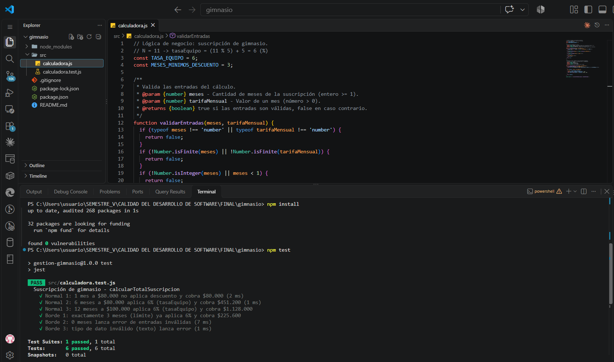

# Gestión de Gimnasio – Pruebas Unitarias con Jest

**Programa:** Tecnología en Desarrollo de Software – CIAF
**Asignatura:** Calidad del Desarrollo de Software (Grupo viernes)
**Tema:** Pruebas Unitarias Automatizadas con Jest y Gestión de Versiones con Git/GitHub

## Integrante (trabajo individual)

| N.º de lista oficial | Nombre completo |
|----------------------|-----------------|
| 11 | Hurtado Morales Víctor Hugo |

- **Valor de N:** 11
- **tasaEquipo:** (11 mod 5) + 5 = 1 + 5 = **6 %**

## Negocio elegido

Suscripción de gimnasio. El cliente paga por una cantidad de meses a una tarifa mensual.

### Reglas de cálculo

1. `subtotal = meses × tarifaMensual`.
2. **Condición:** si la suscripción es de **3 meses o más**, se aplica un descuento del **6 % (tasaEquipo)** sobre el subtotal.
3. `total = subtotal − (subtotal × 6 / 100)`. Con menos de 3 meses, `total = subtotal`.
4. Validación: `meses` debe ser un número entero ≥ 1 y `tarifaMensual` un número > 0. Si no se cumple, se lanza un error.

### Funciones (`src/calculadora.js`)

- `validarEntradas(meses, tarifaMensual)`: devuelve `true` o `false`.
- `calcularTotalSuscripcion(meses, tarifaMensual)`: devuelve el total a pagar o lanza `Error` si las entradas son inválidas.

## Casos de prueba (6)

| N.º | Tipo | Entrada (meses, tarifa) | Salida esperada |
|-----|------|-------------------------|-----------------|
| 1 | Normal | 1, 80000 | 80000 (sin descuento) |
| 2 | Normal | 6, 80000 | 451200 (480000 − 6 %) |
| 3 | Normal | 12, 100000 | 1128000 (1200000 − 6 %) |
| 4 | Borde (límite) | 3, 80000 | 225600 (240000 − 6 %) |
| 5 | Borde (cero) | 0, 80000 | Error: «Entradas inválidas» |
| 6 | Borde (tipo inválido) | '5', 80000 | Error: «Entradas inválidas» |

Las pruebas 2, 3 y 4 verifican exactamente el resultado matemático con la tasaEquipo del 6 %.

## Ejecución

```bash
npm install
npm test
```

## Captura de `npm test`


